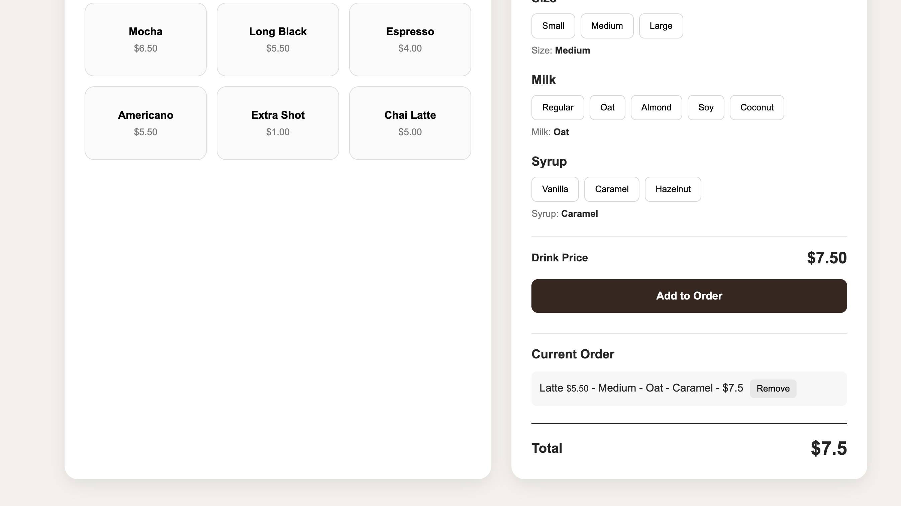
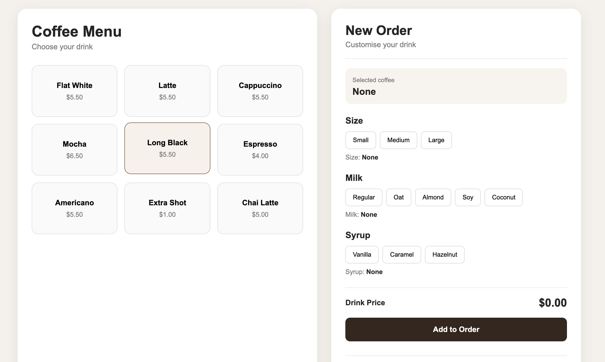

# ☕ Coffee Shop POS

A simple Point of Sale (POS) application for a coffee shop, built with HTML, CSS, and JavaScript.

This project allows a barista to create and manage coffee orders by selecting a drink, size, milk type, and syrup.

## Features

- Select different coffee drinks
- Choose Small, Medium, or Large size
- Price changes depending on the selected size
- Choose different milk options
- Add syrup
- Automatically calculate the drink price
- Add drinks to the current order
- Add multiple drinks to the same order
- Calculate the total order price
- Remove drinks from the order
- Automatically update the total when an item is removed

## Technologies

- HTML
- CSS
- JavaScript

## How It Works

1. Select a coffee.
2. Select the size.
3. Choose a milk option.
4. Choose a syrup.
5. The application calculates the drink price.
6. Click **Add to Order**.
7. The drink is added to the current order.
8. Add more drinks if needed.
9. The application calculates the total price of the order.
10. Drinks can be removed from the order using the **Remove** button.

## What I Practiced

While building this project, I practiced:

- JavaScript variables
- Objects
- Functions
- `for` loops
- Event listeners
- DOM manipulation
- `querySelectorAll()`
- `getElementById()`
- `dataset`
- `createElement()`
- `appendChild()`
- Working with prices and numbers
- Updating the UI based on user interaction

## Future Improvements

In the future, I would like to add:

- Customer registration
- Loyalty system
- Free coffee after a certain number of purchases
- Hold orders
- Payment options
- Order history
- Better validation
- Local storage

## Author

## Screenshot

Emiliano Rivas